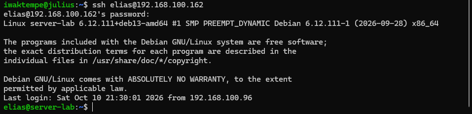
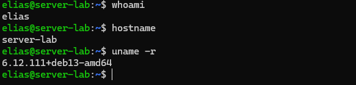
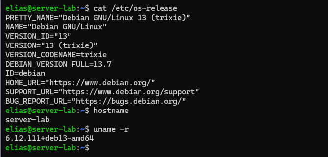
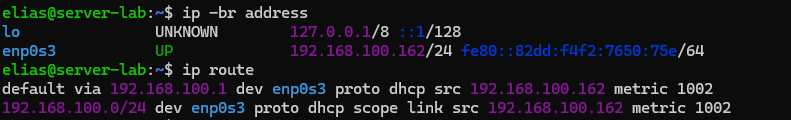
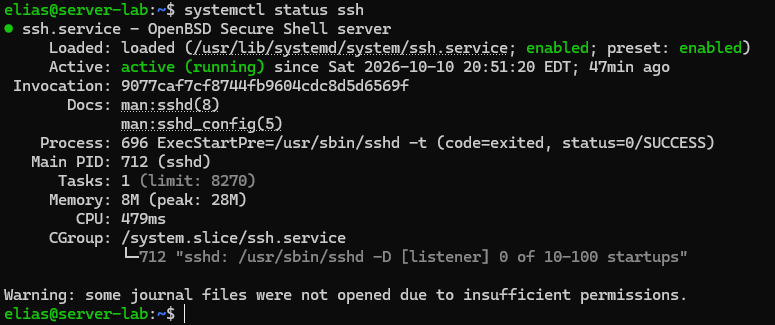

# Linux Server Remote Access — Home Lab

A personal Linux home lab project focused on Debian server administration and secure remote access using SSH.

## Overview

This project demonstrates a Debian Linux server running inside VMware Workstation and accessed remotely from a separate laptop using Debian on Windows Subsystem for Linux (WSL).

The virtual machine uses Bridged networking to connect to the local network, allowing the laptop to reach the server over the home network.

## Objectives

- Practice basic Debian Linux server administration.
- Configure and use SSH for remote server access.
- Understand VMware Bridged networking.
- Establish connectivity between separate devices on a local network.
- Document configuration, testing, and troubleshooting.

## Lab Environment

| Component | Configuration |
|---|---|
| Server OS | Debian GNU/Linux 13 (Trixie) |
| Hostname | `server-lab` |
| Virtualization | VMware Workstation |
| Network Mode | Bridged |
| Client Device | Windows laptop with Debian on WSL |
| Remote Access | SSH |
| Network | Home local network |

## Network Architecture

```text
Laptop
└── Windows
    └── Debian on WSL
        │
        │ SSH over the local network
        ▼
    Home Wi-Fi / LAN
        │
        ▼
    VMware Bridged Network
        │
        ▼
    Debian Linux Server
    (Virtual Machine)
```

## Implementation

1. Set up a Debian Linux virtual machine in VMware Workstation.
2. Configure the VM to use Bridged networking.
3. Configure the SSH service on the Debian server.
4. Connect the laptop to the same local network.
5. Use the SSH client in Debian on WSL to connect to the server.
6. Verify that the remote terminal belongs to the server.

## Verification

**Status: SSH remote login successful.**

## Evidence

### 1. Successful SSH Login


### 2. Remote Command Verification


### 3. Server Information


### 4. Network Configuration


### 5. SSH Service Status


The laptop successfully established an SSH session with the Debian server and accessed its terminal remotely.

Additional evidence and verification commands will be documented as the project develops.

## Security Considerations

- Do not publish passwords or private SSH keys.
- Avoid exposing sensitive network information in screenshots.
- Do not expose the SSH service to the public internet without appropriate security controls.

## Future Improvements

- Document SSH configuration and service management.
- Add sanitized screenshots of successful remote access.
- Create a network topology diagram.
- Document troubleshooting steps.
- Explore SSH key-based authentication.

## Author

Personal learning project documenting practical Linux system administration and networking skills.
